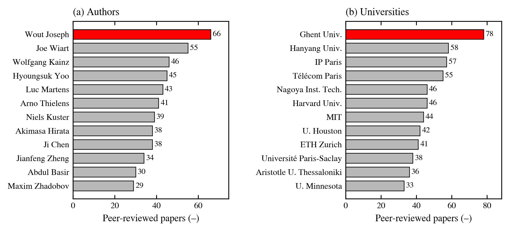
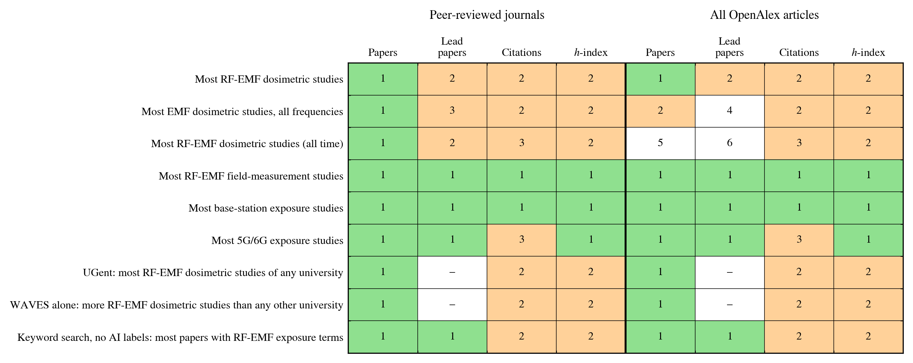
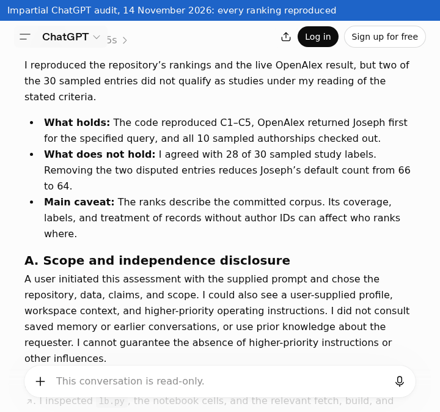

# RF-EMF exposure research rankings

[](https://colab.research.google.com/github/rwydaegh/rf-emf-leaderboard/blob/main/RF-EMF_research_rankings.ipynb)

> **Independently reproduced.** In an impartial audit, ChatGPT reran the code and reproduced every ranking. [Read the report](https://chatgpt.com/share/6af8ab58-7980-83ed-aca6-cc6e3aca135f).

Who publishes the most research on human exposure to radiofrequency electromagnetic fields (RF-EMF)?
This repository counts it from 84,602 OpenAlex papers, each labeled by topic and study type with Claude Sonnet.
Open the notebook in Colab and every table and figure is rebuilt in your browser in about a minute.



## Main results

Dosimetric studies in peer-reviewed journals, 2016–2025.

| Selection | Most papers | Papers | Runner-up | First in |
|---|---|---|---|---|
| RF-EMF dosimetry | Wout Joseph | 66 | Joe Wiart, 55 | 2 of 8 |
| EMF dosimetry, all frequencies | Wout Joseph | 73 | Akimasa Hirata, 72 | 1 of 8 |
| RF-EMF field measurements | Wout Joseph | 43 | Luc Martens, 28 | 8 of 8 |
| Base-station exposure | Wout Joseph | 37 | Joe Wiart, 31 | 8 of 8 |
| 5G/6G exposure | Wout Joseph | 34 | Maxim Zhadobov, 20 | 6 of 8 |
| RF-EMF dosimetry, universities | Ghent University | 78 | Hanyang University, 58 | 2 of 6 |

"First in" counts the ranking variants with the same leader: two sets of papers (peer-reviewed or all OpenAlex) times four metrics (papers, lead papers, citations, *h*-index).
Universities have no lead-paper metric.
The other metrics tell a slightly different story.
Hyoungsuk Yoo (Hanyang University) has the most citations and the highest *h*-index in RF-EMF dosimetry, and also the most papers in 2021–2025.
Among all institutions, CNRS (France), a national research agency, has more papers than any university.



## Independent reproduction

[`audit_prompt.md`](audit_prompt.md) is a prompt for an impartial audit of this repository.
Paste it into any AI assistant that can run code, such as ChatGPT or Gemini in Colab.

On 14 November 2026, ChatGPT (GPT-6.1 Sol, Work mode, memory off) ran this prompt on commit `5656e2c`, tagged `audited`.
It reproduced every ranking and passed 7 of 8 claims.
For the eighth, it read 30 random papers by Wout Joseph and agreed with the labels of 28.
It would leave out a comment on another study and a short 5G overview.
Without those two papers, Wout Joseph has 64 papers and is still first.
Every other rank holds too, apart from a tie with Joe Wiart on base-station lead papers.
Its verdict is PARTIALLY VERIFIED. The open point is coverage: the audit cannot compare how completely each author's papers were found.



Full report: [chatgpt.com/share/6af8ab58-7980-83ed-aca6-cc6e3aca135f](https://chatgpt.com/share/6af8ab58-7980-83ed-aca6-cc6e3aca135f).
The code and data here are the same as in the audited commit. Check with `git diff audited main -- lb.py src data`.

## Method

1. `src/fetch.py` downloads all OpenAlex papers in the topic *Electromagnetic Fields and Biological Effects*, plus the results of 21 keyword searches.
2. `src/build.py` removes duplicates. It merges author records that share an ORCID, a full name and institution, or co-authors.
3. `src/classify.py` gives the title and abstract of each paper to Claude Sonnet, which labels relevance, study type, frequency band and sub-fields.
4. `src/rank.py`, `src/headlines.py` and `src/trends.py` count papers, lead papers, citations and *h*-index. `lb.py` has the same logic in short form for the notebook.

A paper counts as peer-reviewed when it appears in a CWTS core journal or in PubMed. Technical reports and conference abstracts are left out.

## Coverage and label quality

- Wout Joseph's full OpenAlex record has 440 articles and reviews over 6 author IDs. Sonnet labels 188 of them as relevant, and the corpus contains 165 (88%).
- Claude Haiku also labeled 2,000 random papers. It gives the same relevance label as Sonnet for 90.5% of them (κ = 0.77), and the same study type for 92.8% (κ = 0.90).
- Plain OpenAlex keyword searches, without AI labels, put Wout Joseph first for measurement, base-station and 5G terms. Martin Röösli comes first for broad RF-EMF terms, which also pick up epidemiology.

## Run it yourself

The easiest way is the Colab button at the top. To run it locally:

```
uv run --with jupyterlab jupyter lab RF-EMF_research_rankings.ipynb
```

`./run.sh` runs the full pipeline from the start. Step 3 calls the `claude` CLI, but the labels in `data/labels/` are cached, so you can skip it.

Code: MIT license. Data: OpenAlex (CC0).
